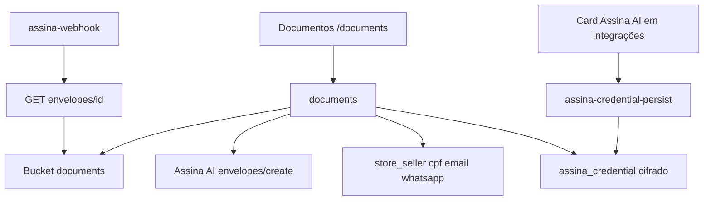
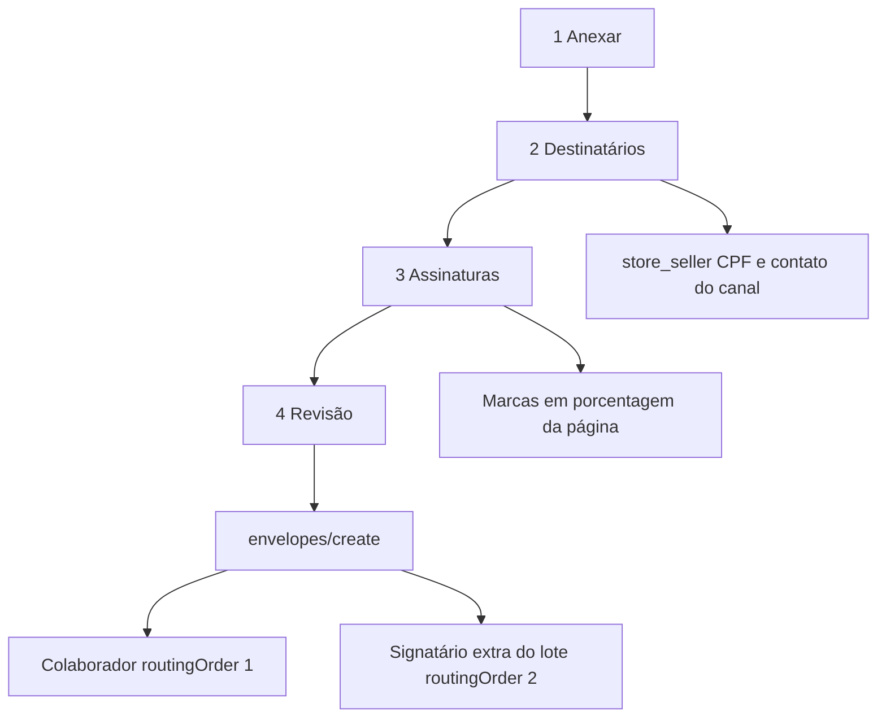

# Assinatura de documentos — Design

**Spec**: `.specs/features/document-signing/spec.md`
**Status**: Draft

O corte, o disparo e o webhook rodam em Edge Functions. A tela só mostra e pede. O token não chega no navegador. Não há decisão de projeto anterior em `.specs/STATE.md`.

---

## Architecture Overview

O gestor sobe o PDF para um bucket privado. A função lê o texto, monta a revisão e, na confirmação, cria um envelope por PDF pronto. O webhook só acorda a função: o status que vale é o que a própria API devolve quando a função busca o envelope com o token da empresa.



---

## Code Reuse Analysis

### Existing Components to Leverage

| Component | Location | How to Use |
| --- | --- | --- |
| Card do Millennium | `src/pages/settings/ErpIntegrationPage.tsx` | Segundo card na mesma grade. Ícone `/assinaai.png`, mais largo que o quadrado de 26px, para o logo inteiro aparecer. |
| Cifra do segredo | `supabase/functions/shopping-credential-persist/index.ts` | AES-GCM com `ERP_SECRET_KEY`. A resposta não devolve o token. |
| Quem é Gestor | `supabase/functions/_shared/staffAuth.ts` | `loadStaffCaller` com `OWNER_ROLES`. |
| Loja do topo | `src/pages/dashboard/useScope.ts` | Uma filial ou todas. O lote guarda essa escolha. |
| Barra, tabela, selo | `src/components/ui/ProgressBar.tsx`, `DataTable.tsx`, `Badge.tsx`, `Card.tsx` | Lote no mesmo desenho da Meta. |
| Menu do Gestor | `src/layout/nav-wedash.ts` | Item solto, como Estoque, só em `navOwner`. |
| Sync da ficha | `workers/millennium-sync/src/deps.ts` `syncStoreSellers` | O upsert não manda `cpf`, `email` nem `whatsapp`. Esses campos sobrevivem ao sync. |

### Integration Points

| System | Integration Method |
| --- | --- |
| Assina AI | `POST /api/v1/envelopes/create`, `GET /api/v1/envelopes/{id}`, `GET /api/v1/folders/list` para testar o token, `POST /api/v1/envelopes/resend-signer-link/{envelopeId}/{recipientId}` |
| Postgres | Tabelas novas. `store_seller` ganha `cpf`. |
| Storage | Bucket privado `documents`. O navegador não lê o bucket direto. A função devolve URL assinada na hora de abrir. |

---

## Components

### Card Assina AI

- **Purpose**: Grava um token da empresa e mostra Conectado ou Não configurado.
- **Location**: `src/pages/settings/ErpIntegrationPage.tsx`
- **Interfaces**: o card chama `saveAssinaToken(token)` e `fetchAssinaStatus()`.
- **Dependencies**: `assina-credential-persist`
- **Reuses**: o card do Millennium

### Tela Documentos

- **Purpose**: Pastas e lotes. Novo lote abre a revisão e a confirmação.
- **Location**: `src/pages/documents/DocumentsPage.tsx`
- **Interfaces**: a tela chama `prepareBatch`, `assignDocument`, `saveEmployeeContact`, `confirmBatch`, `resendDocument`, `openDocument`, `listDocuments`.
- **Dependencies**: `useScope`, função `documents`
- **Reuses**: `PageHeader`, `Card`, `DataTable`, `ProgressBar`, `Badge`, `Modal`, `Button`, `EmptyState`

### Função do token

- **Purpose**: Testa o token, cifra e guarda. Não grava se a API recusar.
- **Location**: `supabase/functions/assina-credential-persist/index.ts`
- **Interfaces**:
  - `POST { token: string }` testa `GET /api/v1/folders/list`. 200 grava e devolve `{ status: "connected" }`. 401 devolve "Token inválido." e não grava.
  - `POST { clear: true }` apaga o token e devolve `{ status: "not_configured" }`.
  - `POST {}` devolve `{ status: "connected" | "not_configured" }` sem o token.
- **Dependencies**: `ERP_SECRET_KEY`, `loadStaffCaller`
- **Reuses**: cifra de `shopping-credential-persist`

### Função dos documentos

- **Purpose**: Corte, revisão, envio, reenvio e abertura do arquivo.
- **Location**: `supabase/functions/documents/index.ts`
- **Interfaces**:
  - `prepare({ storeId, month, year, category, unify, sourcePaths })` lê cada PDF, agrupa e devolve a revisão. Não cria envelope.
  - `assign({ documentId, sellerId })` prende a página a uma ficha e continua sem envelope.
  - `saveContact({ sellerId, cpf, email, whatsapp })` grava na ficha. Campo vazio limpa e-mail ou WhatsApp. CPF inválido não grava.
  - `confirm({ batchId, channel, deadline, reminder })` cria envelope só da linha pronta, até 5 MB, com contato do canal.
  - `resend({ documentId })` só se o status é Pendente.
  - `open({ documentId })` devolve URL assinada da cópia. Se a cópia assinada falta, busca o envelope de novo e grava.
  - `list({ storeId })` devolve pastas e lotes do escopo.
- **Dependencies**: bucket, `assina_credential`, `store_seller`
- **Reuses**: `staffAuth`

### Webhook

- **Purpose**: Acordar a cópia do status. O corpo do webhook não é a fonte do status.
- **Location**: `supabase/functions/assina-webhook/index.ts`
- **Interfaces**:
  - `POST` com `eventId` e `envelopeId`. `eventId` repetido não muda nada. Envelope que não é nosso responde 200 e não grava.
  - Para envelope nosso, `GET /api/v1/envelopes/{id}` com o token. O corpo do webhook não decide o status. `COMPLETED` marca Assinado e baixa o arquivo. Se o download falha, continua Assinado e a URL temporária não vira o arquivo. `DECLINED` marca Recusado. `EXPIRED` marca Expirado. `CANCELED` marca Recusado.
- **Dependencies**: `verify_jwt = false` em `supabase/config.toml`. As outras funções seguem `verify_jwt = true`.
- **Reuses**: o cliente HTTP da função de envio

### Corte do PDF

- **Purpose**: Texto por página, CPF e PDF novo com as páginas escolhidas.
- **Location**: `supabase/functions/_shared/pdfSplit.ts` e `src/data/wedash/documentSplit.ts` para a regra pura, testável sem rede.
- **Interfaces**:
  - `cpfDigits(value): string | null` — 11 dígitos e dígitos verificadores.
  - `firstCpf(text): string | null` — primeiro CPF válido da página.
  - `groupPages(pages, unify): groups` — ligado, um grupo por CPF; desligado, um grupo por página.
  - `fileName(category, taken): string` — `Holerite.pdf`, depois `Holerite (2).pdf`.
  - `batchSigned(docs): boolean` — verdadeiro só quando todos estão Assinados.
- **Dependencies**: `unpdf` para o texto, `pdf-lib` para copiar páginas. `pdf-lib` não extrai texto.
- **Reuses**: nada de PDF no repositório hoje

---

## Data Models

### assina_credential

```typescript
interface AssinaCredential {
  tenantId: string
  tokenCipher: string
  updatedAt: string
}
```

**Relationships**: uma linha por tenant. O papel `authenticated` não lê esta tabela.

### store_seller (coluna nova)

```typescript
interface EmployeeContact {
  id: string
  tenantId: string
  storeId: string
  cpf: string | null
  email: string | null
  whatsapp: string | null
}
```

**Relationships**: `cpf` não é único. Dois CPFs iguais ficam sem dono até alguém escolher.

### document_batch

```typescript
interface DocumentBatch {
  id: string
  tenantId: string
  storeId: string | null
  month: number
  year: number
  category: string
  unify: boolean
  channel: "EMAIL" | "WHATSAPP" | null
  deadline: string | null
  reminder: "EVERY_DAY" | "EVERY_3_DAYS" | "EVERY_WEEK" | "NEVER"
}
```

**Relationships**: `storeId` nulo significa que o lote nasceu com todas as filiais. O status do lote não é coluna: é Assinado se todos os documentos estão Assinados, senão Pendente.

### document

```typescript
interface SignedDocument {
  id: string
  batchId: string
  tenantId: string
  storeId: string
  sellerId: string | null
  status: "UNASSIGNED" | "PENDING" | "SIGNED" | "DECLINED" | "EXPIRED"
  envelopeId: string | null
  recipientId: string | null
  storagePath: string
  signedStoragePath: string | null
  pageCount: number
  sizeBytes: number
  error: string | null
}
```

**Relationships**: sem `sellerId` a linha é a página sem dono. `PENDING` é Pendente na tela. `DECLINED` e `EXPIRED` são Recusado e Expirado. `CANCELED` na API grava `DECLINED`.

### document_event

```typescript
interface DocumentEvent {
  eventId: string
  envelopeId: string
  receivedAt: string
}
```

**Relationships**: chave primária `eventId`.

### Bucket

Objetos em `documents/{tenantId}/{batchId}/{documentId}.pdf` e `.../{documentId}-signed.pdf`. Privado. Limite do objeto de origem: 15 MB. MIME `application/pdf`.

---

## Error Handling Strategy

| Error Scenario | Handling | User Impact |
| --- | --- | --- |
| PDF sem texto | A função recusa o arquivo | "Arquivo escaneado não é aceito. Envie o PDF gerado pelo sistema de folha." |
| Mais de 5 PDFs, acima de 15 MB ou de 1.000 páginas, ou não PDF | Recusa aquele arquivo | As frases da spec |
| Página sem CPF, CPF desconhecido ou CPF repetido | `sellerId` nulo, sem envelope | A revisão pede o colaborador |
| Sem WhatsApp ou sem e-mail do canal | A linha não entra no `create` | "Sem WhatsApp neste cadastro." ou "Sem e-mail neste cadastro." |
| Prazo vazio | `confirm` não envia | "Informe a data limite." |
| PDF pronto acima de 5 MB | A linha fica na revisão | "O PDF passa de 5 MB. Desligue a unificação ou separe o arquivo." |
| 401, 429, 5xx ou timeout no create | A linha segue sem `envelopeId` e grava `error` | A falha aparece na linha. As outras linhas do lote seguem. |
| Confirmar de novo | Linha com `envelopeId` é pulada | Não nasce envelope duplicado |
| Sem token | `confirm` não chama a API | "A conexão com o Assina AI ainda não foi configurada. Acesse Conta › Integrações para conectar." |
| Token recusado no teste | Não grava | "Token inválido." |
| Download do PDF assinado falha | Marca Assinado e não guarda a URL | Abrir o arquivo busca a cópia de novo |
| Abrir Assinado sem cópia | `open` busca o envelope e grava | O gestor recebe a URL da cópia nova |
| Webhook de envelope alheio ou `eventId` repetido | 200 e nada muda | Ninguém vê |

---

## Risks & Concerns

| Concern | Location (file:line) | Impact | Mitigation |
| --- | --- | --- | --- |
| `unpdf` já quebrou em Edge Function quando o `configureUnPDF` não era awaited | issue [unjs/unpdf#3](https://github.com/unjs/unpdf/issues/3) | O corte não lê o CPF | Import com `await configureUnPDF` antes de extrair. O teste do extrator usa um PDF pequeno com texto. A regra de grupo é pura e não depende da lib. |
| PDF de 15 MB e 1.000 páginas na memória da função | sem uso de PDF no repo | A função pode estourar tempo ou memória | Um arquivo por chamada. Se estourar, aquele arquivo volta com a falha e os outros seguem. Não há OCR. |
| Webhook sem assinatura na coleção publicada | `docs.assinaai.com`, pasta Webhooks | Um POST forjado poderia marcar Assinado | O webhook só acorda. O status sai do `GET /envelopes/{id}` com o token. Um POST sem esse GET não muda a linha. |
| Upsert do sync | `workers/millennium-sync/src/deps.ts:812` | Um payload futuro com `cpf: null` apagaria o CPF | O sync continua sem essas colunas. A migration não coloca default que o upsert reescreva. |
| Nenhum teste de PDF hoje | repo sem `pdf-lib` | Regressão no CPF e no sufixo do arquivo | Testes de `cpfDigits`, `groupPages`, `fileName` e `batchSigned` em `src/data/wedash`. |
| Logo horizontal | `public/assinaai.png` | Quadrado de 26px esmaga o nome | O card usa o arquivo com largura livre, `object-contain`. |

---

## Tech Decisions

| Decision | Choice | Rationale |
| --- | --- | --- |
| Onde roda | Edge Functions, não o worker do Fly | O sync fica com Millennium e Stone. O padrão de segredo já é função. |
| Fonte do status | `GET /api/v1/envelopes/{id}` | A coleção não assina o webhook. |
| Texto e corte | `unpdf` lê, `pdf-lib` copia páginas | `pdf-lib` declara que não extrai texto. |
| JWT do webhook | `verify_jwt = false` só em `assina-webhook` | O Assina AI não manda JWT do Supabase. O resto das funções permanece `verify_jwt = true`. |
| Upload | O navegador sobe o original no bucket por URL assinada de upload, uma por arquivo | O corpo da função não carrega 15 MB. |
| Posição | Substituída em 2026-10-15: uma marca `SIGNATURE` no centro da última página, arrastável. Ver a seção abaixo. | O centro de todas as páginas era o atalho do v1. |
| Quem entra na pasta | Todo `store_seller` com `in_erp = true`, qualquer cargo | Holerite não é só de quem vende. |
| Nome do mês | Janeiro … Dezembro | A pasta do exemplo é Outubro, não `10`. |

---

## Envio com destinatários e marcas (2026-10-15)

O corte do PDF não muda. Muda o wizard depois do anexo e o corpo do `envelopes/create`.



### Passos

1. **Anexar** continua como está: até 5 PDFs, corte por CPF, unificar sempre.
2. **Destinatários.** Uma linha por documento. Canal WhatsApp ou e-mail. Se a ficha já tem CPF e o contato desse canal, a linha não pede nada: nome e canal, e o envio lê o cadastro. O campo de contato só aparece quando aquele canal está vazio; o CPF só aparece quando a ficha não tem. Gravou, não pede de novo. Prazo e lembrete uma vez, no topo, para o lote. Signatário extra opcional: nome, canal e o contato desse canal. Botão Replicar na linha: a pessoa marca os outros colaboradores e copia o canal. O contato de cada um não é copiado.
3. **Assinaturas.** Um PDF de amostra, uma página por vez, setas para trocar de página. A marca de assinar começa no centro da última página e pode ser arrastada. Rubrica é um interruptor; começa desligado. A posição do signatário extra também é marcada nesse PDF e vale para o lote. Replicar aqui copia as marcas do colaborador para os colaboradores marcados. Se o destino não tiver a página, a linha fica sem aquela marca e a revisão avisa.
4. **Revisão.** Só leitura. Cada linha mostra pessoa, canal e "Assinatura na página N". Se houver rubrica, "Rubrica na página N". O signatário extra aparece uma vez, acima da lista. Enviar grava o contato que ainda estava só na tela e cria o envelope. Linha com envelope não é enviada de novo.

### O que o envelope passa a levar

Os dois destinatários usam `action: "SIGN"` e `authenticationType: "DEFAULT_SIGN"`. O colaborador vai em `routingOrder: 1` com o canal da linha. O extra, se existir, vai em `routingOrder: 2` com o canal dele. `signaturePositions` deixa de ser uma marca no centro de cada página. Cada marca é `{ pageNumber, x, y, element }`, com `x` e `y` em porcentagem, como o `50`/`50` de hoje. `recipient_id` gravado continua o do colaborador, para o reenvio do link.

### Dados

`employee_document.channel` guarda `EMAIL` ou `WHATSAPP`. `employee_document.marks` guarda as marcas do colaborador. `document_batch.extra_signer` guarda nome, canal, contato e marcas do extra. `document_batch.channel` deixa de mandar no envio. Prazo e lembrete continuam no lote.

O navegador desenha a página com `pdfjs-dist` só nesse passo. O repo não tem render de PDF no cliente; `pdf-lib` e `unpdf` ficam na função e não pintam a página.

### Riscos desta alteração

| Concern | Location | Impact | Mitigation |
| --- | --- | --- | --- |
| `save-contact` exige CPF e regrava e-mail e WhatsApp juntos | `supabase/functions/documents/index.ts:249` | Preencher só o WhatsApp apaga o e-mail ou recusa a ficha sem CPF | O save desta etapa grava só o campo visível e o CPF quando ele foi pedido. Campo oculto não é enviado. |
| Nome do `element` da rubrica | coleção do Assina AI não relida nesta sessão | Um valor inventado faz o create falhar | A rubrica fica na tela desligada até o nome constar na coleção. Sem isso, o envelope sai só com `SIGNATURE`. |
| `recipientIdOf` lê a primeira signature | `supabase/functions/_shared/assinaApi.ts:68` | O reenvio pode pegar o extra se a API devolver o extra primeiro | Gravar o id do destinatário com `routingOrder` 1. O reenvio segue nesse id. |
| PDF grande no navegador | não há `pdfjs` no app | A página de amostra pode pesar | Renderiza uma página por vez, no documento escolhido, não os cinco PDFs juntos. |
